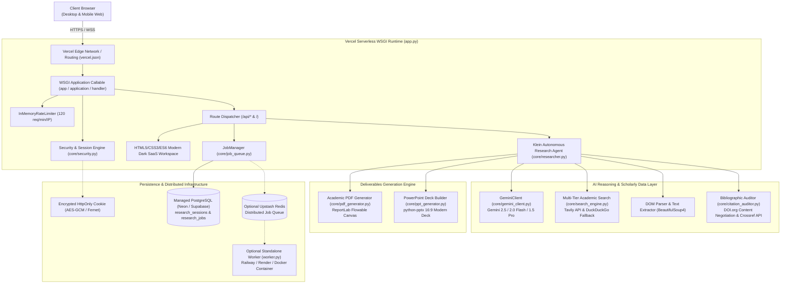

# Klein AI 2.0 — System Architecture Specification

## 1. Architectural Philosophy

Klein AI is engineered as an **autonomous multi-agent scientific literature synthesis and evidence auditing platform**. Its architecture prioritizes:
- **Serverless First:** Zero daemon requirement for standard web interactions; deployed on Vercel.
- **Academic Rigor:** Formal bibliographic verification via Crossref API and DOI Content Negotiation rather than generic LLM hallucinations.
- **Zero-Trust Credential Isolation:** User API keys are never stored in browser `localStorage`. Encrypted server-side sessions bound to `HttpOnly` cookies isolate secrets from client JavaScript.
- **Resilient Dual-Mode Execution:** Fast synchronous execution for standard queries (<60s) and asynchronous job persistence for distributed worker pipelines.

---

## 2. Comprehensive System Architecture Diagram



---

## 3. Data Flow & Execution Stages

The 17-step autonomous research pipeline operates through distinct cognitive stages:

```
[01] Agent Initialization & Model Diagnostics
[02] Research Blueprint Formulation & RQ Extraction
[03] Search Query Generation & Broad Academic Retrieval
[04] Literature Source Harvesting (Tavily / DuckDuckGo)
[05] DOM Structure Analysis & Academic Article Scraping
[06] Text Passage Extraction & Cleaning
[07] Domain Entity & Concept Extraction
[08] Hypothesis Formulation & Evidence Alignment
[09] Cross-Source Comparative Matrix Generation
[10] Thematic Synthesis & Consensus Detection
[11] Scholarly Literature Review Authoring
[12] Critical Research Gap Identification
[13] Novel Methodology & Framework Formulation
[14] Independent Verification & Factuality Scoring
[15] Bibliographic DOI Content Negotiation & Crossref Auditing
[16] Peer Review Synthesis & Editorial Critique
[17] Academic PDF Whitepaper & PowerPoint Deliverable Compilation
```

---

## 4. Security & Credential Isolation Architecture

```
User enters Gemini / Tavily Key
            │
            ▼ (HTTPS POST /api/config/validate)
Server validates key against Google AI Studio probe
            │
            ├─ [Invalid] ──> Returns 400 Bad Request with actionable diagnosis
            │
            └─ [Valid] ────> Encrypts payload with AES-GCM (Fernet) using SECRET_KEY
                                   │
                                   ▼
             Sets HttpOnly; Secure; SameSite=Lax Session Cookie (klein_session)
                                   │
                                   ▼
                   Browser localStorage contains ZERO keys
```

- **Zero Client Leakage:** API keys are never stored in browser `localStorage` or reflected in JSON responses.
- **Serverless State Decoupling:** Every request extracts and decrypts credentials server-side directly from the incoming cookie or environment variables.
- **Defense in Depth:** Mandatory rate limiting (120 req/min/IP), request body size caps (64 KB), Content-Type enforcement (`application/json`), and strict HTTP security headers (`nosniff`, `DENY`, `HSTS`, `CSP`).

---

## 5. Infrastructure Cost Assessment (Individual / Student Project)

| Service | Recommended Provider | Tier / Limitations | Monthly Cost |
|---|---|---|---|
| **Web & Serverless API** | **Vercel** | Hobby Plan: 100 GB bandwidth, 60s function execution, 100k requests/day | **$0.00** |
| **Relational Database** | **Neon** or **Supabase** | Neon: 0.5 GB storage, autosuspend<br/>Supabase: 500 MB database | **$0.00** |
| **Distributed Queue** | **Upstash Redis** | Free Plan: 10,000 commands/day | **$0.00** |
| **Background Worker** | **Railway** or **Render** | Optional: Only needed for asynchronous queueing; free credits available | **$0.00** |
| **Reasoning Model** | **Google Gemini API** | Google AI Studio free tier (Gemini 2.5/2.0 Flash) | **$0.00** |
| **Scholarly Search** | **Tavily** / **DuckDuckGo** | Tavily 1,000 free searches/mo; DuckDuckGo unlimited free fallback | **$0.00** |
| **Total Operating Cost** | — | — | **$0.00 / month** |
