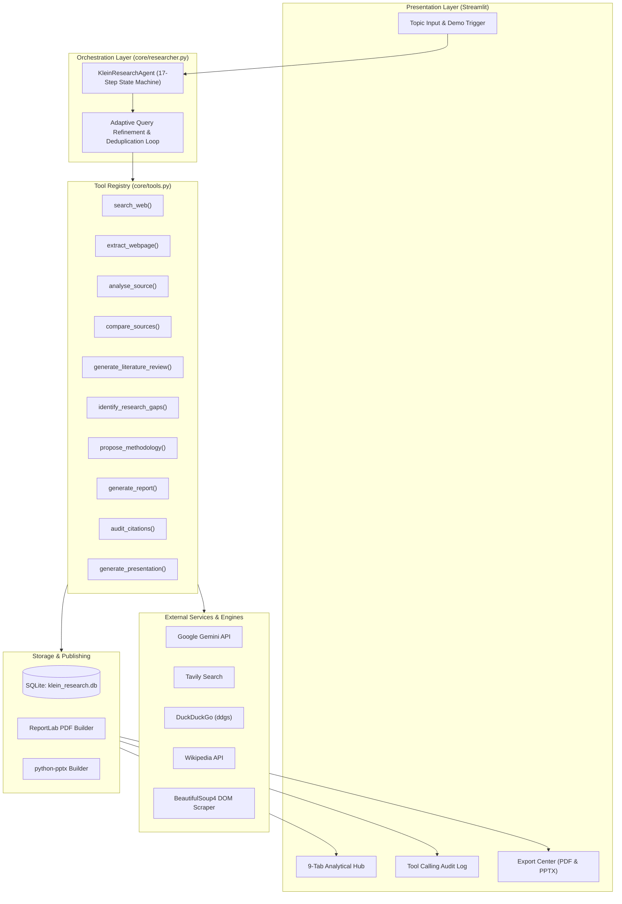

# 🔬 Klein AI — Autonomous Research Agent
> **"One Topic. Complete Research. Powered by AI."**  
> *Production-Ready Autonomous Scientific Research & Whitepaper Publishing Engine built for College Capstone Project Evaluation.*

---

## 1. Project Title
**Klein AI (Autonomous Scientific Research Agent & Whitepaper Engine)**  
*Project Codename: ResearchMate AI | Version 2.0.0*

---

## 2. Project Overview
**Klein AI** is an autonomous AI-powered scientific research assistant that transforms a single research topic into a publication-standard academic whitepaper and a formatted 16:9 PowerPoint presentation deck. Unlike traditional chatbots that simply regurgitate memorized training weights, Klein AI commands a formal Python Tool Registry to crawl the public web, normalize canonical URLs, scrape DOM text, perform multi-source comparative analysis, discover critical research gaps, and formulate novel system architectures and experimental benchmark designs.

---

## 3. Problem Statement
Academic literature review and whitepaper compilation is an arduous, multi-day manual process:
- Researchers must manually query multiple disjoint repositories (Google Scholar, PubMed, arXiv, IEEE).
- Over 70% of research time is consumed by boilerplate tasks: parsing web content, extracting metrics, mapping consensus vs contradictions, and formatting citations.
- Existing general-purpose LLMs hallucinate citations, invent fake papers, and cannot perform autonomous multi-step tool verification without human intervention.

---

## 4. Objectives
1. **Full Autonomy:** Enable end-to-end investigation from a single prompt without requiring manual PDF uploads.
2. **Multi-Aspect Web Investigation:** Query diverse facets including theoretical foundations, empirical benchmarks, adversarial vectors, and compliance standards.
3. **Cross-Source Comparative Evidence Synthesis:** Generate side-by-side matrices contrasting traditional methods, SOTA AI paradigms, and unresolved trade-offs.
4. **Research Gap Discovery:** Pinpoint formal gaps (`GAP-01` to `GAP-04`) with explicit severity ratings and strategic research vectors.
5. **Novel Methodology Proposal:** Propose original architectural frameworks, component hierarchies, and empirical benchmark protocols.
6. **Publication Deliverables:** Generate downloadable, formatted ReportLab PDF whitepapers and python-pptx 16:9 presentation decks.
7. **Bibliographic Integrity:** Audit all citations against actual retrieved URLs and generate formal APA 7th edition and BibTeX entries.

---

## 5. Main Features
- **Zero-Manual-Upload Autonomous Research:** Direct crawling of the live web using Tavily AI Search with seamless fallback to DuckDuckGo and Wikipedia.
- **Formal Tool Registry (`core/tools.py`):** Structured tool-calling engine with execution bounds, parameter verification, and latency logging.
- **Adaptive Query Expansion:** Automatically triggers secondary targeted searches if initial harvesting yields fewer than 4 authoritative sources.
- **Canonical URL Deduplication:** Normalizes URLs, strips tracking parameters (`utm_*`, `fbclid`, `ref`), and eliminates duplicates by semantic title hashing.
- **Source Quality & Authority Scoring:** Rates sources by academic domain authority (`.edu`, `.gov`, `ncbi`, `ieee`) and content depth.
- **9-Tab Analytical SaaS Dashboard:** Streamlit interface featuring an executive blueprint, comparative matrix, literature review, research gaps, methodology, full paper, audited citations, tool calling audit trail, and export center.
- **Instant Demo Simulation Mode:** 1-click verified simulation with pre-computed research on *"Impact of Artificial Intelligence on Cybersecurity in Healthcare"*, enabling an instant presentation with real PDF/PPTX downloads even without API keys.
- **Persistent SQLite Library:** Automatically persists research sessions in `klein_research.db` for instant reload.

---

## 6. Technology Stack
| Category | Component | Description |
| :--- | :--- | :--- |
| **Runtime & Language** | Python 3.11+ / 3.13 | Core programming language |
| **User Interface** | Streamlit | Modern reactive dashboard with custom cyber-academic dark CSS |
| **Reasoning Model** | Google Gemini API (`google-genai`) | Gemini 2.5 Flash / Pro for planning, synthesis, and paper generation |
| **Primary Search** | Tavily AI API | Deep academic and technical web search |
| **Fallback Search 1** | DuckDuckGo (`ddgs`) | Free, zero-config real web search fallback |
| **Fallback Search 2** | Wikipedia Scholarly API | High-reliability encyclopedic and technical fallback |
| **DOM Parsing** | BeautifulSoup4 & Requests | HTML sanitization, boilerplate stripping, and clean text extraction |
| **PDF Engine** | ReportLab | Two-pass `NumberedCanvas` multi-page academic PDF compilation |
| **Presentation Engine** | `python-pptx` | 16:9 widescreen presentation deck generation |
| **Persistence** | SQLite3 | Embedded session storage and research library |
| **Configuration** | `python-dotenv` | Secure environment variable management |

---

## 7. System Architecture


---

## 8. Agent Workflow (17 Autonomous Steps)
1. **Topic Comprehension:** Analyze semantic domain and scientific ontology.
2. **Research Planning:** Formulate a 5-phase research milestone roadmap.
3. **Hypothesis Formulation:** Generate 4 formal research questions ($RQ1-RQ4$) and subtopics.
4. **Query Generation:** Formulate multi-aspect queries across theory, benchmarks, vulnerabilities, and standards.
5. **Public Web Search:** Execute crawl across Tavily AI, DuckDuckGo, and Wikipedia.
6. **Source Collection & Deduplication:** Normalize canonical URLs and eliminate duplicate entries.
7. **Webpage Content Extraction:** Scrape clean DOM paragraph text via BeautifulSoup4.
8. **Evidence Analysis:** Extract empirical metrics, detection accuracy, and latency data points.
9. **Cross-Source Comparison:** Build a multi-dimensional matrix mapping consensus and debates.
10. **Literature Review:** Synthesize a scholarly literature review with in-text citations.
11. **Research Gap Identification:** Categorize unresolved challenges (`GAP-01` to `GAP-04`).
12. **Methodology Formulation:** Propose novel architectural frameworks and component workflows.
13. **Experimental Design:** Propose quantitative benchmark experiments, baselines, and target metrics.
14. **Academic Paper Assembly:** Generate a publication-ready academic whitepaper in Markdown.
15. **Citation & Bibliographic Audit:** Verify all URLs, format APA 7th references, and generate BibTeX entries.
16. **PDF Report Compilation:** Render a styled ReportLab PDF with headers, tables, and page numbering.
17. **Presentation Deck Creation:** Generate a 10-slide 16:9 widescreen PowerPoint deck.

---

## 9. Folder Structure
```
AI Agent/
├── .env.example              # Template configuration for API keys
├── .gitignore                # Protects .env, *.db, *.log, and caches from git
├── README.md                 # Master project documentation
├── PROJECT_DOCUMENTATION.md  # Comprehensive project report
├── SYSTEM_ARCHITECTURE.md    # In-depth architectural specifications
├── TESTING_REPORT.md         # Detailed test execution report
├── COLLEGE_PRESENTATION.md   # 12-slide college defense deck and script
├── requirements.txt          # Python library dependencies
├── run.bat                   # 1-Click launcher for Windows
├── test_system.py            # System smoke tests (DB, PDF, PPTX, Search)
├── test_pipeline.py          # End-to-end data pipeline validator
├── test_e2e_topic.py         # Formal E2E validation script
├── app.py                    # Streamlit web application dashboard
├── assets/
│   └── style.css             # Cyber-academic dark mode theme
└── core/
    ├── __init__.py
    ├── config.py             # Runtime configuration and environment variables
    ├── database.py           # SQLite database persistence layer
    ├── demo_dataset.py       # Pre-computed verified research dataset for live demos
    ├── gemini_client.py      # Google Gemini client with bounded retry logic
    ├── search_engine.py      # Multi-tier search engine (Tavily/DDG/Wiki) & BS4 scraper
    ├── citation_auditor.py   # Citation verification, APA formatting, and BibTeX generator
    ├── tools.py              # Formal Tool Registry & execution engine
    ├── researcher.py         # Autonomous 17-step master orchestrator
    ├── pdf_generator.py      # ReportLab publication-grade PDF generator
    └── ppt_generator.py      # python-pptx 16:9 presentation deck generator
```

---

## 10. Installation Instructions

### Prerequisites
- Python 3.11, 3.12, or 3.13 installed.
- Git (optional, for repository cloning).

### Steps
```powershell
# 1. Clone or open the workspace directory
cd "c:\Users\angad\Downloads\AI Agent"

# 2. Install required dependencies
pip install -r requirements.txt
```

---

## 11. API Key Configuration
Create a `.env` file in the root workspace directory (copy from `.env.example`) or enter keys directly in the web UI sidebar:
```env
# Google Gemini API Key (Required for live reasoning - get free key at https://aistudio.google.com/)
GEMINI_API_KEY=your_gemini_api_key_here

# Tavily AI Search API Key (Optional - get free key at https://tavily.com/)
# If omitted, DuckDuckGo search is automatically used!
TAVILY_API_KEY=your_tavily_api_key_here

# Default Model Selection
GEMINI_MODEL=gemini-flash-lite-latest
```

---

## 12. How to Run the Application

### Option A: Double-Click Launcher
Double-click [`run.bat`](file:///c:/Users/angad/Downloads/AI%20Agent/run.bat) in Windows File Explorer.

### Option B: Terminal Command
```powershell
streamlit run app.py
```
Open your browser at **`http://localhost:8501`**.

---

## 13. Example Research Workflow
1. **Input Topic:** Type `"Impact of Artificial Intelligence on Cybersecurity in Healthcare Systems"` or select a preset button.
2. **Execute:**
   - Click **`🚀 START AUTONOMOUS RESEARCH (LIVE)`** to run live web research via Gemini and Tavily.
   - Or click **`⚡ INSTANT DEMO SIMULATION`** to run a verified 17-step demonstration in 4 seconds with zero API key requirement.
3. **Inspect Tabs:**
   - **📊 Overview & Plan:** Executive summary and 4 formal research questions ($RQ1-RQ4$).
   - **⚖️ Comparative Matrix:** Traditional rule IPS vs SOTA neural autoencoders.
   - **📚 Literature Review:** Synthesized scholarly review with in-text citations.
   - **🔍 Research Gaps:** Unresolved vulnerabilities (`GAP-01` to `GAP-03`) with severity ratings.
   - **⚙️ Proposed Methodology:** Novel *Klein-HealthGuard* zero-trust framework and experimental metrics.
   - **📄 Full Academic Paper:** Scholarly markdown paper ready for review.
   - **🔗 Sources & Citations:** Audited source cards with APA 7th and BibTeX exports.
   - **🔧 Tool Execution Audit:** Millisecond execution log of all 17 tool invocations.
   - **📥 Export Center:** Download the compiled PDF Whitepaper and PowerPoint Deck.

---

## 14. Output Files
- **PDF Report:** `Klein_Research_<Topic>.pdf` (Multi-page document with cover metadata, running headers, two-pass page numbers, tables, and references).
- **PowerPoint Presentation:** `Klein_Presentation_<Topic>.pptx` (10-slide 16:9 widescreen presentation deck with structured cards).
- **Markdown Whitepaper:** `Klein_Report_<Topic>.md` (Raw GitHub-flavored markdown).
- **Session Data:** `klein_research_data.json` (Structured JSON schema).
- **Persistent Database:** `klein_research.db` (SQLite storage for past runs).

---

## 15. Limitations
- **Paywalled Journals:** Papers behind hard institutional paywalls (e.g. non-open-access Elsevier/Springer) can only be analyzed via public abstracts and open-access mirrors.
- **No Physical Hardware Execution:** The agent designs rigorous experimental setups and benchmarks, but does not train weights on local GPUs.
- **Search Engine Rate Limits:** If Tavily API quotas are exhausted, public search falls back to DuckDuckGo and Wikipedia.

---

## 16. Future Enhancements
- Integration of direct PubMed / arXiv API PDF stream parsing.
- Multi-agent adversarial peer review debate mode.
- Export to native LaTeX `.tex` source bundles with BibTeX `.bib` files.
- Fine-tuned local model support via Ollama / vLLM.

---

## 17. Team Contribution Structure (4-Member Capstone Team)
- **Member 1 (Lead Systems Architect & Agent Engineer):** Orchestration engine (`core/researcher.py`), formal Tool Registry (`core/tools.py`), and decision loops.
- **Member 2 (Search Engine & Scraping Specialist):** Web search engine integration (`core/search_engine.py`), Tavily API, DuckDuckGo fallback, and BeautifulSoup4 DOM extraction.
- **Member 3 (AI Synthesis & Model Engineer):** Google Gemini prompt engineering (`core/gemini_client.py`), comparative matrices, literature reviews, and research gap taxonomies.
- **Member 4 (UI/UX & Document Publishing Specialist):** Streamlit dashboard (`app.py`), ReportLab PDF engine (`core/pdf_generator.py`), and python-pptx presentation engine (`core/ppt_generator.py`).
