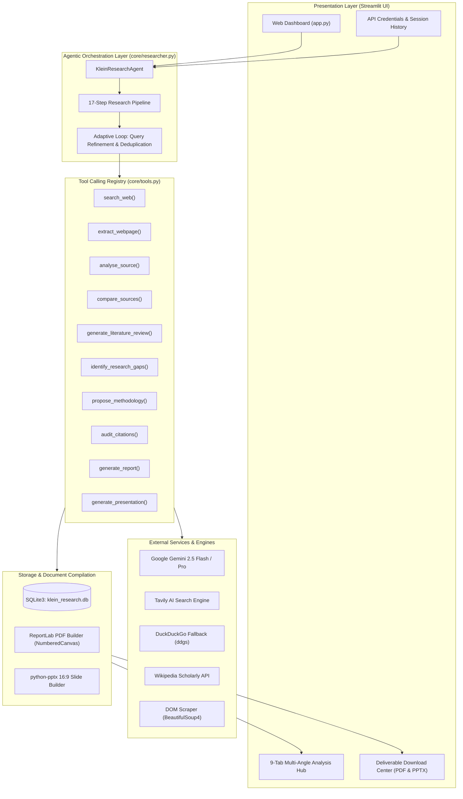

# 🏛️ Klein AI — System Architecture & Workflow

## 1. High-Level Architecture Diagram

---

## 2. End-to-End Pipeline Execution Flow

```mermaid
sequenceDiagram
    autonumber
    actor User
    participant Streamlit as Web UI (app.py)
    participant Orchestrator as KleinResearchAgent
    participant Tools as ToolRegistry
    participant Search as SearchEngine (Tavily/DDG)
    participant Gemini as Gemini AI Model
    participant SQLite as Database (klein_research.db)
    participant Exporters as PDF & PPTX Engines

    User->>Streamlit: Enter Research Topic & Click Start
    Streamlit->>Orchestrator: execute_research(topic)
    
    rect rgb(30, 41, 59)
        note over Orchestrator,Gemini: Phase 1: Planning & Question Formulation
        Orchestrator->>Gemini: analyze_topic_and_plan(topic)
        Gemini-->>Orchestrator: Blueprint (Objectives, 4 RQs, 4 Subtopics)
        Orchestrator->>Gemini: generate_search_queries(topic, subtopics, RQs)
        Gemini-->>Orchestrator: Multi-Aspect Queries List
    end

    rect rgb(15, 23, 42)
        note over Orchestrator,Search: Phase 2: Web Research & DOM Extraction
        loop For each aspect query
            Orchestrator->>Tools: execute_tool("search_web", query, aspect)
            Tools->>Search: search_query(query)
            Search-->>Tools: Candidate Sources
        end
        Orchestrator->>Orchestrator: Canonical URL Normalization & Deduplication
        opt If unique sources < 4
            Orchestrator->>Orchestrator: Trigger Adaptive Query Expansion
        end
        loop For each deduplicated source
            Orchestrator->>Tools: execute_tool("extract_webpage", url)
            Tools-->>Orchestrator: Cleaned DOM Content & Quality Tier
        end
    end

    rect rgb(30, 27, 75)
        note over Orchestrator,Gemini: Phase 3: Evidence Synthesis & Methodology
        Orchestrator->>Tools: execute_tool("compare_sources", topic, sources)
        Tools->>Gemini: analyze_and_compare_sources()
        Gemini-->>Orchestrator: Comparative Matrix & Contradictions
        Orchestrator->>Tools: execute_tool("generate_literature_review", topic, sources)
        Tools->>Gemini: generate_literature_review()
        Gemini-->>Orchestrator: Thematic Lit Review Markdown
        Orchestrator->>Tools: execute_tool("identify_research_gaps", lit_review)
        Gemini-->>Orchestrator: GAPs Taxonomy (GAP-01 to GAP-04)
        Orchestrator->>Tools: execute_tool("propose_methodology", gaps)
        Gemini-->>Orchestrator: Framework, Experiments & Target Metrics
        Orchestrator->>Tools: execute_tool("generate_report", ...)
        Gemini-->>Orchestrator: Complete Academic Paper
    end

    rect rgb(19, 78, 74)
        note over Orchestrator,Exporters: Phase 4: Verification & Artifact Compilation
        Orchestrator->>Tools: execute_tool("audit_citations", sources)
        Tools-->>Orchestrator: Audited APA References & BibTeX
        Orchestrator->>Exporters: build_pdf_report(bundle)
        Exporters-->>Orchestrator: PDF Binary
        Orchestrator->>Exporters: build_pptx_deck(bundle, slides)
        Exporters-->>Orchestrator: PPTX Binary
        Orchestrator->>SQLite: save_session(session_id, data)
    end

    Orchestrator-->>Streamlit: Complete Research Bundle
    Streamlit-->>User: Render 9 Interactive Tabs & Instant Download Buttons
```

---

## 3. Data Schema Specifications

### `research_sessions` Table (SQLite)
| Column | Type | Description |
| :--- | :--- | :--- |
| `id` | `TEXT PRIMARY KEY` | Unique 8-character session identifier (e.g. `a1b2c3d4`) |
| `topic` | `TEXT NOT NULL` | Raw research topic entered by user |
| `created_at` | `TEXT NOT NULL` | Timestamp formatted as `YYYY-MM-DD HH:MM:SS` |
| `status` | `TEXT NOT NULL` | Execution status: `Completed (Verified)` |
| `source_count` | `INTEGER` | Total deduplicated empirical sources gathered |
| `summary` | `TEXT` | 400-character executive abstract preview |
| `data_json` | `TEXT NOT NULL` | Complete serialized JSON object containing all sections |

---

## 4. Resilience and Failover Matrix

| Potential Failure Point | Fallback Mechanism | Impact on User |
| :--- | :--- | :--- |
| Tavily API key missing or quota exhausted | Automatically switches to **DuckDuckGo Search (`ddgs`)** | Zero interruption; real search continues |
| DuckDuckGo rate-limited | Automatically switches to **Wikipedia Scholarly API** | Verified encyclopedic sources harvested |
| Webpage protected / 403 / Paywall | Inaccessible handler retains clean search snippet and tags status | Pipeline proceeds without crashing |
| Google Gemini API transient 429 rate limit | Bounded exponential backoff with random jitter (up to 3 retries) | Transparent retry recovery |
| Non-ASCII / Emoji in ReportLab PDF generation | Typographical normalization and Latin-1 code point sanitization | PDF renders flawlessly without encoding crash |
| Network offline / No API keys during live college demo | **⚡ Instant Demo Simulation Mode** with pre-computed dataset | Evaluator can inspect all 17 steps and downloads in 4 seconds |
